# Resultados reales de la práctica DHCP con dos servidores

Este documento recoge las **capturas reales** obtenidas al ejecutar la práctica
([enunciado y guía](PRACTICA_DHCP_DOS_SERVIDORES.md)) en un equipo **Ubuntu 24.04**.

## Cómo se ha montado el laboratorio

En lugar de tres máquinas virtuales de VirtualBox se han usado **tres *network namespaces*** de
Linux en la misma máquina Ubuntu. A efectos de DHCP el comportamiento es el mismo: cada
namespace tiene su propia pila de red, su interfaz `enp0s3` y su propia MAC, y los tres están
conectados a un *bridge* `red-dhcp`, que hace el papel de la "Red interna" de VirtualBox.

| Equipo | Namespace | MAC | IP |
|---|---|---|---|
| DHCP-SRV1 | `srv1` | 08:00:27:00:00:02 | 192.168.50.2/24, pool .100–.149 |
| DHCP-SRV2 | `srv2` | 08:00:27:00:00:03 | 192.168.50.3/24, pool .200–.229 |
| CLIENTE | `cli` | 08:00:27:aa:bb:cc | DHCP |

- Servidores: `isc-dhcp-server` 4.4.3-P1 con [dhcpd-srv1.conf](lab/dhcpd-srv1.conf) /
  [dhcpd-srv2.conf](lab/dhcpd-srv2.conf) (concesión de 300 s, misma puerta de enlace, sin `authoritative`).
- Cliente: `isc-dhcp-client` (`dhclient`) 4.4.3-P1.
- Captura: `tcpdump` sobre el bridge y análisis con **Wireshark 4.2.2** / `tshark`.
- Logs: como no hay systemd en el entorno, los demonios se ejecutan en primer plano (`-d`) y su
  salida se guarda con marca de tiempo. Las líneas son exactamente las mismas que se verían con
  `journalctl -u isc-dhcp-server` y `journalctl -t dhclient`.

Scripts para reproducirlo: [`lab/lab.sh`](lab/lab.sh) (montar/desmontar la red y arrancar/parar
servidores y cliente), [`lab/repetir10.sh`](lab/repetir10.sh), [`lab/retardo_srv2.sh`](lab/retardo_srv2.sh),
[`lab/parte3y4.sh`](lab/parte3y4.sh) y [`lab/parte5.sh`](lab/parte5.sh).

```bash
sudo apt install isc-dhcp-server isc-dhcp-client tcpdump wireshark iproute2
sudo ./lab/lab.sh up && sudo ./lab/lab.sh start-srv1 && sudo ./lab/lab.sh start-srv2
sudo ./lab/lab.sh cli-start          # el cliente hace DORA
```

Todos los ficheros `.pcap` están en [`capturas/`](capturas/) y se pueden abrir con Wireshark
(filtro `dhcp`).

> **Nota sobre las capturas.** `tcpdump` se ejecutó sobre el bridge, que ve **todas** las tramas,
> incluidas las unicast entre el cliente y un servidor. En una red real el switch no entregaría
> esas tramas unicast al otro servidor. Para saber qué ha recibido realmente cada servidor hay
> que mirar su log.

---

## Parte 1. Dos servidores reciben un DISCOVER

Ficheros: [parte1-2_dora.pcap](capturas/parte1-2_dora.pcap) ·
[log cliente](capturas/parte1-2_cliente.log) · [log SRV1](capturas/parte1-2_srv1.log) ·
[log SRV2](capturas/parte1-2_srv2.log)

**Cliente** (`dhclient -v`):

```
06:49:34.130 DHCPDISCOVER on enp0s3 to 255.255.255.255 port 67 interval 3 (xid=0x1fee9d7f)
06:49:35.112 DHCPOFFER of 192.168.50.200 from 192.168.50.3
06:49:35.114 DHCPREQUEST for 192.168.50.200 on enp0s3 to 255.255.255.255 port 67 (xid=0x7f9dee1f)
06:49:35.116 DHCPACK of 192.168.50.200 from 192.168.50.3 (xid=0x1fee9d7f)
06:49:35.145 bound to 192.168.50.200 -- renewal in 115 seconds.
```

**SRV1 (192.168.50.2), el que pierde:**

```
06:49:34.111 DHCPDISCOVER from 08:00:27:aa:bb:cc via enp0s3
06:49:35.125 DHCPOFFER on 192.168.50.100 to 08:00:27:aa:bb:cc (vm) via enp0s3
06:49:35.128 DHCPREQUEST for 192.168.50.200 (192.168.50.3) from 08:00:27:aa:bb:cc via enp0s3: unknown lease 192.168.50.200.
```

**SRV2 (192.168.50.3), el que gana:**

```
06:49:34.110 DHCPDISCOVER from 08:00:27:aa:bb:cc via enp0s3
06:49:35.112 DHCPOFFER on 192.168.50.200 to 08:00:27:aa:bb:cc (vm) via enp0s3
06:49:35.114 DHCPREQUEST for 192.168.50.200 (192.168.50.3) from 08:00:27:aa:bb:cc (vm) via enp0s3
06:49:35.116 DHCPACK on 192.168.50.200 to 08:00:27:aa:bb:cc (vm) via enp0s3
```

```
$ ip -n cli -4 -br addr show enp0s3
enp0s3@if19      UP             192.168.50.200/24
$ ip -n cli route
default via 192.168.50.1 dev enp0s3
192.168.50.0/24 dev enp0s3 proto kernel scope link src 192.168.50.200
```

| Pregunta | Resultado observado |
|---|---|
| 1. IP recibida | **192.168.50.200** |
| 2. Pool | **.200–.229 → pool de SRV2** |
| 3. Servidor que la concede | **SRV2 (192.168.50.3)**: `DHCPACK of 192.168.50.200 from 192.168.50.3` |
| 4. ¿Ambos reciben el DISCOVER? | **Sí.** Los dos registran `DHCPDISCOVER from 08:00:27:aa:bb:cc` en el mismo milisegundo |
| 5. ¿Ambos envían OFFER? | **Sí.** SRV1 ofrece `.100` y SRV2 ofrece `.200` |
| 6. Oferta seleccionada | La de **SRV2**, que llegó primero (0,5 ms antes que la de SRV1) |
| 7. ¿Obligatorio elegir la primera? | No (RFC 2131). `dhclient` lo hace porque `select-timeout` vale 0 por defecto. Su log ni siquiera muestra la segunda oferta, que llegó cuando ya había elegido |
| 8. ¿Cómo se entera el perdedor? | Recibe el **DHCPREQUEST broadcast** con el Server Identifier `(192.168.50.3)`, que no es el suyo. Registra `unknown lease 192.168.50.200` y **no responde** |

> En la primera prueba, ambas ofertas tardan ~1 s. Es el **ping-check** de `dhcpd`: antes de
> ofrecer una IP que nunca ha concedido, hace ping a esa dirección y espera hasta 1 s por si ya
> estuviera en uso.

---

## Parte 2. Capturar DORA con Wireshark

### Vista general: 1 DISCOVER, 2 OFFER, 1 REQUEST, 1 ACK, todos con el mismo Transaction ID

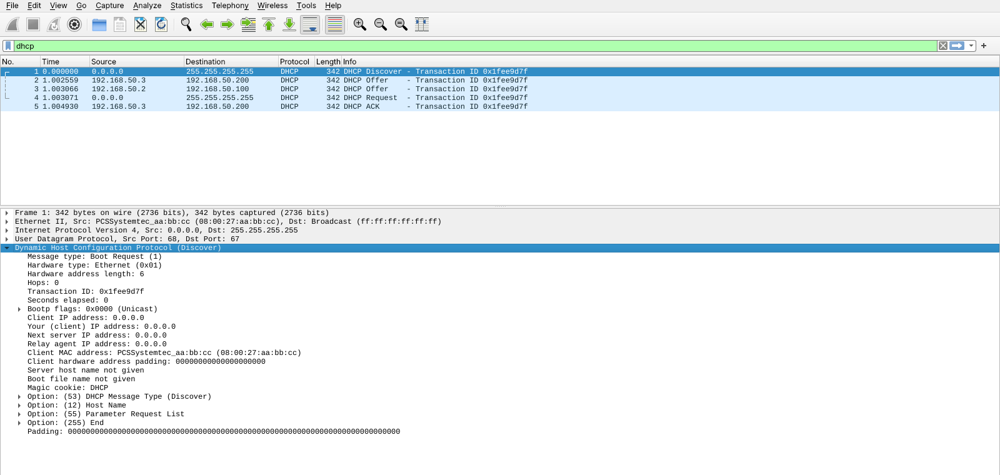

`tshark` sobre la misma captura:

| # | t (s) | Origen | Destino | Tipo | yiaddr | Opt 54 Server Id | Opt 50 Requested IP | Router | Lease |
|---|---|---|---|---|---|---|---|---|---|
| 1 | 0.000000 | 0.0.0.0 | 255.255.255.255 | **Discover** | 0.0.0.0 | – | – | – | – |
| 2 | 1.002559 | 192.168.50.3 | 192.168.50.200 | **Offer (SRV2)** | 192.168.50.200 | 192.168.50.3 | – | 192.168.50.1 | 300 |
| 3 | 1.003066 | 192.168.50.2 | 192.168.50.100 | **Offer (SRV1)** | 192.168.50.100 | 192.168.50.2 | – | 192.168.50.1 | 300 |
| 4 | 1.003071 | 0.0.0.0 | 255.255.255.255 | **Request** | 0.0.0.0 | **192.168.50.3** | 192.168.50.200 | – | – |
| 5 | 1.004930 | 192.168.50.3 | 192.168.50.200 | **ACK (SRV2)** | 192.168.50.200 | 192.168.50.3 | – | 192.168.50.1 | 300 |

Transaction ID común: `0x1fee9d7f`.

### OFFER de SRV2 (llega primero)

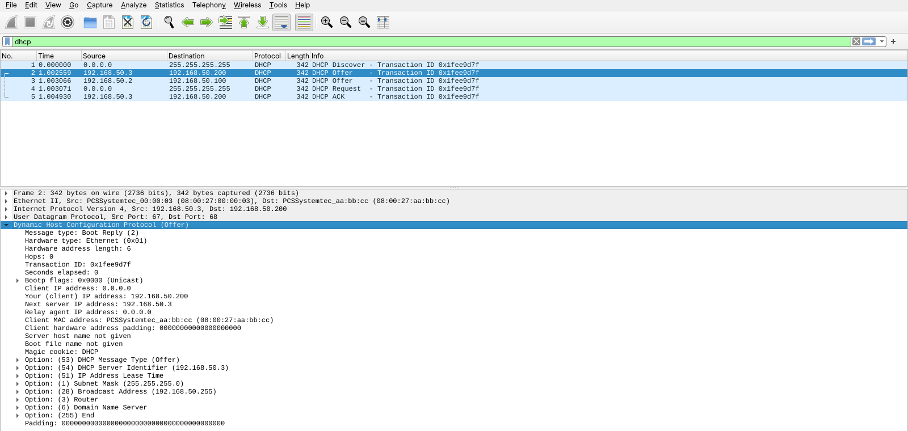

### OFFER de SRV1 (llega 0,5 ms después)

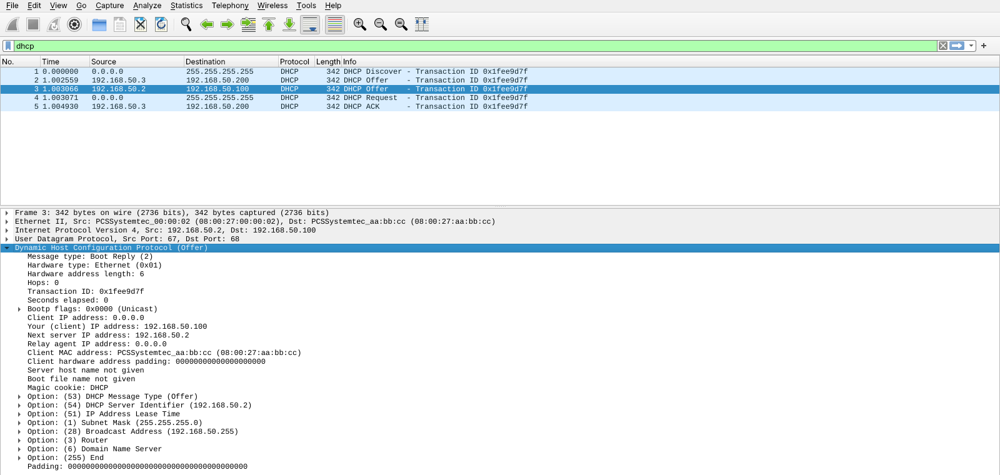

### DHCPREQUEST: Option (54) DHCP Server Identifier = 192.168.50.3

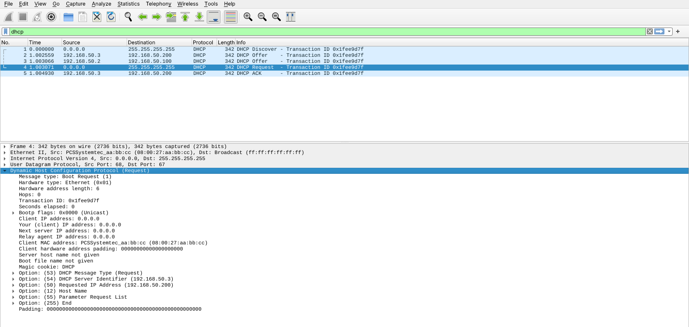

### DHCPACK de SRV2

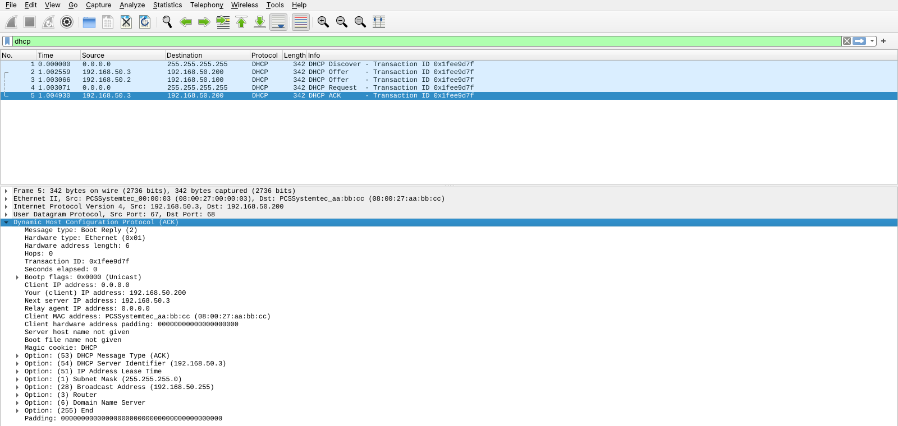

| Pregunta | Resultado observado |
|---|---|
| 9. Nº de DHCPDISCOVER | **1** |
| 10. Nº de DHCPOFFER | **2** |
| 11. IP del servidor de cada OFFER | Trama 2: **192.168.50.3** (SRV2) · Trama 3: **192.168.50.2** (SRV1) |
| 12. Dirección ofrecida por SRV1 | **192.168.50.100** |
| 13. Dirección ofrecida por SRV2 | **192.168.50.200** |
| 14. Server Identifier en el REQUEST | **192.168.50.3** (y Requested IP Address = 192.168.50.200) |
| 15. ¿Coincide con el servidor seleccionado? | **Sí** |
| 16. ¿Quién envía el ACK? | **SRV2 (192.168.50.3)**. SRV1 no envía nada |

Detalle observado: los OFFER y el ACK van con IP destino la **IP ofrecida** y MAC destino la
**MAC del cliente**, es decir, en unicast a nivel 2. Aun así el cliente los acepta, porque
todavía no tiene IP configurada. El DISCOVER y el REQUEST van a `255.255.255.255` /
`ff:ff:ff:ff:ff:ff`.

### 17. Diez repeticiones

Script [`lab/repetir10.sh`](lab/repetir10.sh). En cada prueba se ejecuta `dhclient -r`, se borra el
fichero de concesiones del cliente y se lanza `dhclient` de nuevo (DORA completo).
Captura: [parte2_10_repeticiones.pcap](capturas/parte2_10_repeticiones.pcap).

| Prueba | IP obtenida | Pool | Servidor que la concede | Primer OFFER recibido |
|---|---|---|---|---|
| 1 | 192.168.50.200 | SRV2 (.200-.229) | SRV2 (192.168.50.3) | SRV2 |
| 2 | 192.168.50.200 | SRV2 (.200-.229) | SRV2 (192.168.50.3) | SRV2 |
| 3 | 192.168.50.100 | SRV1 (.100-.149) | SRV1 (192.168.50.2) | **SRV1** |
| 4 | 192.168.50.200 | SRV2 (.200-.229) | SRV2 (192.168.50.3) | SRV2 |
| 5 | 192.168.50.200 | SRV2 (.200-.229) | SRV2 (192.168.50.3) | SRV2 |
| 6 | 192.168.50.200 | SRV2 (.200-.229) | SRV2 (192.168.50.3) | SRV2 |
| 7 | 192.168.50.200 | SRV2 (.200-.229) | SRV2 (192.168.50.3) | SRV2 |
| 8 | 192.168.50.200 | SRV2 (.200-.229) | SRV2 (192.168.50.3) | SRV2 |
| 9 | 192.168.50.200 | SRV2 (.200-.229) | SRV2 (192.168.50.3) | SRV2 |
| 10 | 192.168.50.200 | SRV2 (.200-.229) | SRV2 (192.168.50.3) | SRV2 |

Resultado: **SRV2 gana 9 veces y SRV1 1 vez.** En las 10 pruebas el ganador es el que envía primero
su OFFER.

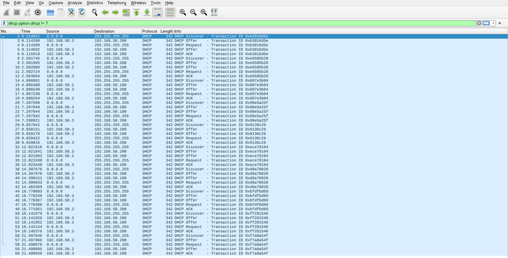

En estas pruebas ambos servidores ya conocían al cliente, así que no hubo ping-check. Las dos
ofertas llegan con **décimas de milisegundo** de diferencia (por ejemplo, en la prueba 3 SRV1 a
+0,39 ms y SRV2 a +0,45 ms), y el orden depende de detalles como qué proceso planifica antes el
sistema operativo.

**18. ¿Gana siempre el mismo servidor?** **No**: en la prueba 3 ganó SRV1. Aun así, uno de los dos
puede ganar la mayoría de las veces sin que el administrador lo haya decidido.

### 19. ¿Influye cuál responde antes? Experimento con SRV2 "lento"

Script [`lab/retardo_srv2.sh`](lab/retardo_srv2.sh). Antes de cada prueba se borra la base de
concesiones de SRV2 y se reinicia. Como ya no conoce al cliente, hace el ping-check y su OFFER
sale **~1 s más tarde**; SRV1 sí conoce al cliente y responde al momento.
Captura: [parte2_retardo_srv2.pcap](capturas/parte2_retardo_srv2.pcap).

```
ronda 1  +    0.0 ms  0.0.0.0         DISCOVER
ronda 1  +    0.4 ms  192.168.50.2    OFFER 192.168.50.2
ronda 1  +    0.6 ms  0.0.0.0         REQUEST 192.168.50.2
ronda 1  +    1.8 ms  192.168.50.2    ACK 192.168.50.2
ronda 1  + 1002.0 ms  192.168.50.3    OFFER 192.168.50.3     <- llega tarde: se ignora
...  (las rondas 2 a 5 son idénticas)
```

| Prueba | IP obtenida | Ganador |
|---|---|---|
| 1 | 192.168.50.100 | SRV1 |
| 2 | 192.168.50.100 | SRV1 |
| 3 | 192.168.50.100 | SRV1 |
| 4 | 192.168.50.100 | SRV1 |
| 5 | 192.168.50.100 | SRV1 |

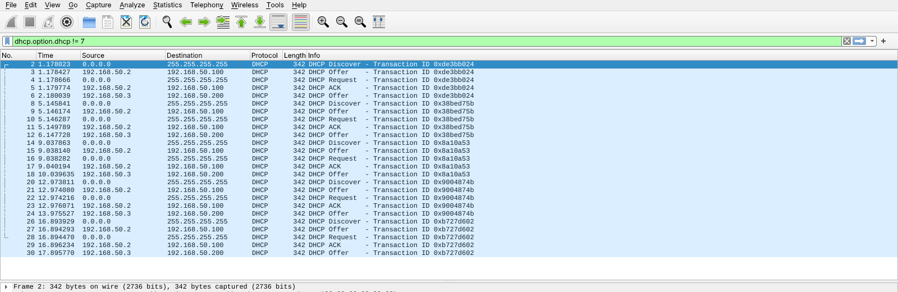

**Sí, influye de forma decisiva:** al retrasar a SRV2, SRV1 gana el 100 % de las veces. El OFFER
tardío de SRV2 llega cuando el cliente ya tiene su ACK y se descarta.

**20.** Por tanto, **no**: con dos servidores independientes el administrador no puede garantizar
cuál gana. Depende de tiempos que no controla: carga, latencia, ping-check, si el servidor ya
conocía al cliente...

**21.** (Pregunta teórica.) Si SRV1 diera de gateway `.1` y SRV2 diera `.254`, el gateway del
cliente dependería de esta carrera: en las pruebas, 9 de cada 10 veces habría recibido `.254` y 1
de cada 10 `.1`. Si una de las dos puertas de enlace no funciona, se producen fallos
intermitentes y difíciles de diagnosticar.

---

## Parte 3. Renovación de la concesión

Ficheros: [parte3_renovacion.pcap](capturas/parte3_renovacion.pcap) ·
[log cliente](capturas/parte3_cliente.log) · [log SRV1](capturas/parte3_srv1.log) ·
[log SRV2](capturas/parte3_srv2.log)

Para que la concesión fuese de SRV1 (como en el enunciado), el cliente la obtuvo con SRV2
parado, y después se arrancó SRV2. Con **los dos servidores encendidos** se esperó a T1:

```
06:52:04.712 bound to 192.168.50.100 -- renewal in 123 seconds.
06:54:07.134 DHCPREQUEST for 192.168.50.100 on enp0s3 to 192.168.50.2 port 67 (xid=0x6184ca33)
06:54:07.137 DHCPACK of 192.168.50.100 from 192.168.50.2 (xid=0x33ca8461)
06:54:07.169 bound to 192.168.50.100 -- renewal in 129 seconds.
```

SRV1:

```
06:54:07.134 DHCPREQUEST for 192.168.50.100 from 08:00:27:aa:bb:cc (vm) via enp0s3
06:54:07.137 DHCPACK on 192.168.50.100 to 08:00:27:aa:bb:cc (vm) via enp0s3
```

SRV2: **ninguna línea DHCP** durante la renovación.

Captura completa de la renovación (solo **2 paquetes**):

| # | Origen | Destino (IP / MAC) | Tipo | ciaddr | Opt 54 | Opt 50 |
|---|---|---|---|---|---|---|
| 1 | 192.168.50.100 | **192.168.50.2 / 08:00:27:00:00:02** | Request | **192.168.50.100** | – | – |
| 2 | 192.168.50.2 | 192.168.50.100 / 08:00:27:aa:bb:cc | ACK | 192.168.50.100 | 192.168.50.2 | – |

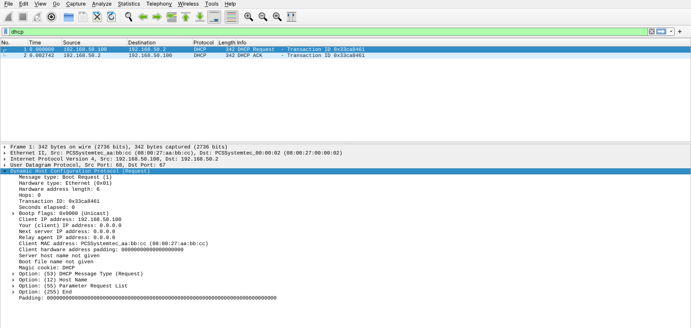

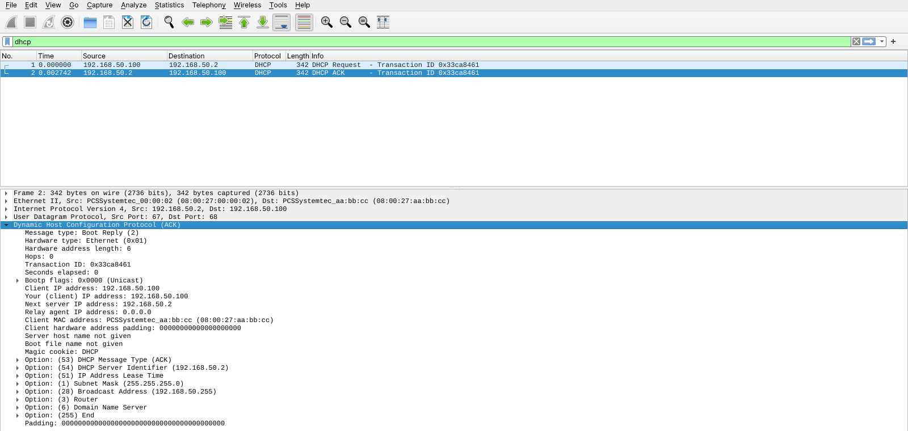

| Pregunta | Resultado observado |
|---|---|
| 22. ¿Nuevo DISCOVER? | **No** |
| 23. ¿Dos OFFER? | **No, ninguno** |
| 24. ¿Con qué servidor renueva? | **SRV1 (192.168.50.2)**, el que concedió la IP, por **unicast** (IP y MAC destino de SRV1). El REQUEST lleva `Client IP address: 192.168.50.100` y no lleva opción 54 ni 50 |
| 25. ¿Misma IP? | **Sí**, 192.168.50.100 |
| 26. Diferencia | Concesión nueva: 4 mensajes broadcast en los que compiten todos los servidores. Renovación: 2 mensajes unicast solo con el servidor original, sin competencia y sin dejar de usar la IP |

> `dhclient` aplica algo de aleatoriedad a T1: "renewal in 123 s" y "129 s" en lugar de exactamente 150 s.

---

## Parte 4. Apagar el servidor que concedió la IP

Ficheros: [parte4_caida_srv1.pcap](capturas/parte4_caida_srv1.pcap) ·
[log cliente](capturas/parte4_cliente.log) · [log SRV2](capturas/parte4_srv2.log) ·
[IP del cliente cada 10 s](capturas/parte4_ip_cliente.txt)

Situación inicial: el cliente tiene **192.168.50.100 de SRV1**, renovada a las **06:54:07**, de modo
que la concesión expira a las **06:59:07** (300 s). A las 06:54:09 se apaga SRV1 y SRV2 sigue encendido.

Log del cliente:

```
06:54:09.594 *** SE APAGA SRV1 ***
                                                   ── RENEWING (unicast a SRV1) ──
06:56:16.479 DHCPREQUEST for 192.168.50.100 on enp0s3 to 192.168.50.2 port 67
06:56:19.670 DHCPREQUEST for 192.168.50.100 on enp0s3 to 192.168.50.2 port 67
06:56:24.609 DHCPREQUEST for 192.168.50.100 on enp0s3 to 192.168.50.2 port 67
06:56:32.896 DHCPREQUEST for 192.168.50.100 on enp0s3 to 192.168.50.2 port 67
06:56:52.177 DHCPREQUEST for 192.168.50.100 on enp0s3 to 192.168.50.2 port 67
06:57:02.694 DHCPREQUEST for 192.168.50.100 on enp0s3 to 192.168.50.2 port 67
06:57:23.580 DHCPREQUEST for 192.168.50.100 on enp0s3 to 192.168.50.2 port 67
06:57:37.999 DHCPREQUEST for 192.168.50.100 on enp0s3 to 192.168.50.2 port 67
06:57:55.437 DHCPREQUEST for 192.168.50.100 on enp0s3 to 192.168.50.2 port 67
06:58:06.752 DHCPREQUEST for 192.168.50.100 on enp0s3 to 192.168.50.2 port 67
06:58:14.992 DHCPREQUEST for 192.168.50.100 on enp0s3 to 192.168.50.2 port 67
06:58:25.975 DHCPREQUEST for 192.168.50.100 on enp0s3 to 192.168.50.2 port 67
                                                   ── REBINDING (broadcast) ──
06:58:40.920 DHCPREQUEST for 192.168.50.100 on enp0s3 to 255.255.255.255 port 67
06:59:00.534 DHCPREQUEST for 192.168.50.100 on enp0s3 to 255.255.255.255 port 67
                                                   ── EXPIRA (06:59:07) → INIT ──
06:59:08.671 DHCPDISCOVER on enp0s3 to 255.255.255.255 port 67 interval 3
06:59:09.673 DHCPOFFER of 192.168.50.200 from 192.168.50.3
06:59:09.676 DHCPREQUEST for 192.168.50.200 on enp0s3 to 255.255.255.255 port 67
06:59:09.680 DHCPACK of 192.168.50.200 from 192.168.50.3
06:59:09.716 bound to 192.168.50.200 -- renewal in 135 seconds.
```

Log de SRV2 en el mismo intervalo. **No ve ninguno de los 12 REQUEST unicast**; solo ve los de
REBINDING y los ignora:

```
06:58:40.919 DHCPREQUEST for 192.168.50.100 from 08:00:27:aa:bb:cc via enp0s3: unknown lease 192.168.50.100.
06:59:00.534 DHCPREQUEST for 192.168.50.100 from 08:00:27:aa:bb:cc via enp0s3: unknown lease 192.168.50.100.
06:59:08.671 DHCPDISCOVER from 08:00:27:aa:bb:cc via enp0s3
06:59:09.673 DHCPOFFER on 192.168.50.200 to 08:00:27:aa:bb:cc (vm) via enp0s3
06:59:09.677 DHCPREQUEST for 192.168.50.200 (192.168.50.3) from 08:00:27:aa:bb:cc (vm) via enp0s3
06:59:09.679 DHCPACK on 192.168.50.200 to 08:00:27:aa:bb:cc (vm) via enp0s3
```

IP del cliente muestreada cada 10 s:

```
06:54:09 ... 06:58:59   192.168.50.100/24      (5 minutos con la IP de SRV1, que está apagado)
06:59:09               192.168.50.200/24      (nueva IP de SRV2)
```

### RENEWING: REQUEST unicast a 192.168.50.2 (tramas 1–12)

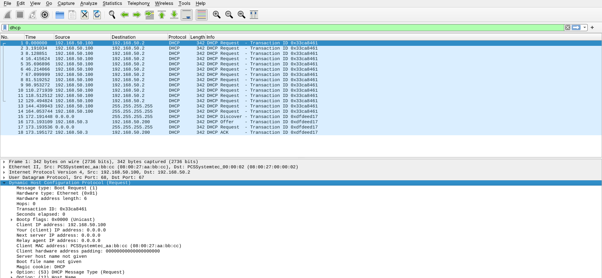

### REBINDING: REQUEST broadcast a 255.255.255.255 (tramas 13–14), después DORA con SRV2

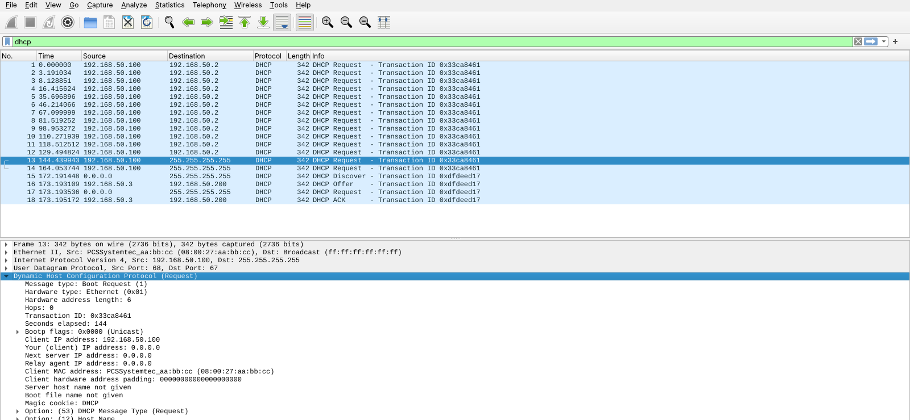

| Pregunta | Resultado observado |
|---|---|
| 27. ¿Pierde la IP al apagar SRV1? | **No.** Sigue con `.100` casi 5 minutos más (06:54:09 → 06:59:07) |
| 28. ¿Puede seguir usándola? | **Sí**, hasta que expira la concesión |
| 29. ¿Qué pasa al renovar con SRV1? | **12 DHCPREQUEST unicast a 192.168.50.2 sin respuesta**, entre 06:56:16 y 06:58:25, con intervalos de 3 a 20 s |
| 30. ¿Interviene SRV2? | En REBINDING recibe los REQUEST pero responde **`unknown lease`** y no dice nada. Interviene **solo cuando la concesión expira** y el cliente hace un nuevo DORA: le da **192.168.50.200**, así que el cliente **cambia de IP** |
| 31. RENEWING vs REBINDING | RENEWING (06:56:16, T1): `to 192.168.50.2` (**unicast**), solo lo ve SRV1. REBINDING (06:58:40, T2 ≈ 273 s ≈ 91 %): `to 255.255.255.255` (**broadcast**), lo ven todos los servidores. Ambos llevan el mismo xid y `ciaddr = 192.168.50.100` |
| 32. Si nadie responde | Al expirar se elimina la IP (06:59:07) y el cliente vuelve a INIT (DISCOVER). Aquí respondió SRV2; sin servidores, el cliente se quedaría sin IPv4 reintentando DISCOVER |

---

## Parte 5. Experimento final

Ficheros: [parte5_experimento_final.pcap](capturas/parte5_experimento_final.pcap) ·
[log cliente](capturas/parte5_cliente.log) · [log SRV1](capturas/parte5_srv1.log) ·
[log SRV2](capturas/parte5_srv2.log)

Secuencia (script [`lab/parte5.sh`](lab/parte5.sh)):

1. Se paran **SRV1 y SRV2**. El cliente libera la concesión (`dhclient -r`; el DHCPRELEASE de la
   trama 1 no lo recibe nadie porque SRV2 está parado), borra su fichero de concesiones y queda
   sin IP.
2. Arranca **solo SRV2** y el cliente pide configuración nueva: DORA completo con **un único OFFER**.
3. Arranca **SRV1** 3 s después.
4. Se observan **dos renovaciones** completas (unos 4 minutos).
5. Extra: se **reinicia el cliente** conservando su fichero de concesión (estado INIT-REBOOT).

Log del cliente:

```
06:59:27.084 *** SRV1 y SRV2 APAGADOS: el cliente libera y olvida su concesion ***
06:59:28.219 *** ARRANCA SOLO SRV2 ***
06:59:29.304 DHCPDISCOVER on enp0s3 to 255.255.255.255 port 67 interval 3 (xid=0x9760b91d)
06:59:29.306 DHCPOFFER of 192.168.50.200 from 192.168.50.3
06:59:29.309 DHCPREQUEST for 192.168.50.200 on enp0s3 to 255.255.255.255 port 67 (xid=0x1db96097)
06:59:29.311 DHCPACK of 192.168.50.200 from 192.168.50.3 (xid=0x9760b91d)
06:59:29.324 bound to 192.168.50.200 -- renewal in 128 seconds.
06:59:32.766 *** ARRANCA SRV1 ***
07:01:37.622 DHCPREQUEST for 192.168.50.200 on enp0s3 to 192.168.50.3 port 67 (xid=0x1db96097)
07:01:37.624 DHCPACK of 192.168.50.200 from 192.168.50.3 (xid=0x9760b91d)
07:01:37.657 bound to 192.168.50.200 -- renewal in 117 seconds.
07:03:34.466 DHCPREQUEST for 192.168.50.200 on enp0s3 to 192.168.50.3 port 67 (xid=0x1db96097)
07:03:34.469 DHCPACK of 192.168.50.200 from 192.168.50.3 (xid=0x9760b91d)
07:03:34.503 bound to 192.168.50.200 -- renewal in 130 seconds.
07:03:38.363 *** REINICIO DEL CLIENTE CONSERVANDO SU CONCESION (INIT-REBOOT) ***
07:03:39.443 DHCPREQUEST for 192.168.50.200 on enp0s3 to 255.255.255.255 port 67 (xid=0x6ab80431)
07:03:39.445 DHCPACK of 192.168.50.200 from 192.168.50.3 (xid=0x3104b86a)
07:03:39.468 bound to 192.168.50.200 -- renewal in 138 seconds.
```

Log de **SRV1** desde que arranca. En más de 4 minutos solo registra **una** línea DHCP, y es para
ignorar al cliente:

```
06:59:32.787 Internet Systems Consortium DHCP Server 4.4.3-P1
07:03:39.432 DHCPREQUEST for 192.168.50.200 from 08:00:27:aa:bb:cc via enp0s3: unknown lease 192.168.50.200.
```

Log de **SRV2**:

```
06:59:29.294 DHCPDISCOVER from 08:00:27:aa:bb:cc (vm) via enp0s3
06:59:29.297 DHCPOFFER on 192.168.50.200 to 08:00:27:aa:bb:cc (vm) via enp0s3
06:59:29.302 DHCPREQUEST for 192.168.50.200 (192.168.50.3) from 08:00:27:aa:bb:cc (vm) via enp0s3
06:59:29.304 DHCPACK on 192.168.50.200 to 08:00:27:aa:bb:cc (vm) via enp0s3
07:01:37.622 DHCPREQUEST for 192.168.50.200 from 08:00:27:aa:bb:cc (vm) via enp0s3
07:01:37.625 DHCPACK on 192.168.50.200 to 08:00:27:aa:bb:cc (vm) via enp0s3
07:03:34.467 DHCPREQUEST for 192.168.50.200 from 08:00:27:aa:bb:cc (vm) via enp0s3
07:03:34.470 DHCPACK on 192.168.50.200 to 08:00:27:aa:bb:cc (vm) via enp0s3
07:03:39.435 DHCPREQUEST for 192.168.50.200 from 08:00:27:aa:bb:cc (vm) via enp0s3
07:03:39.438 DHCPACK on 192.168.50.200 to 08:00:27:aa:bb:cc (vm) via enp0s3
```

Captura completa (11 tramas):

| # | Hora | Origen | Destino | Tipo | Comentario |
|---|---|---|---|---|---|
| 1 | 06:59:28.110 | 192.168.50.200 | 192.168.50.3 | Release | Servidores apagados: nadie lo procesa |
| 2 | 06:59:29.289 | 0.0.0.0 | 255.255.255.255 | Discover | Solo SRV2 encendido |
| 3 | 06:59:29.290 | 192.168.50.3 | 192.168.50.200 | Offer | **Un único OFFER** |
| 4 | 06:59:29.290 | 0.0.0.0 | 255.255.255.255 | Request | Server Id 192.168.50.3 |
| 5 | 06:59:29.290 | 192.168.50.3 | 192.168.50.200 | ACK | IP **192.168.50.200** |
| – | 06:59:32 | | | | **Arranca SRV1** |
| 6 | 07:01:37.620 | 192.168.50.200 | **192.168.50.3** | Request | Renovación 1: unicast a SRV2 |
| 7 | 07:01:37.622 | 192.168.50.3 | 192.168.50.200 | ACK | |
| 8 | 07:03:34.464 | 192.168.50.200 | **192.168.50.3** | Request | Renovación 2: unicast a SRV2 |
| 9 | 07:03:34.466 | 192.168.50.3 | 192.168.50.200 | ACK | |
| 10 | 07:03:39.429 | 0.0.0.0 | 255.255.255.255 | Request | INIT-REBOOT (broadcast) tras reiniciar el cliente |
| 11 | 07:03:39.430 | 192.168.50.3 | 192.168.50.200 | ACK | Responde SRV2; SRV1: `unknown lease` |

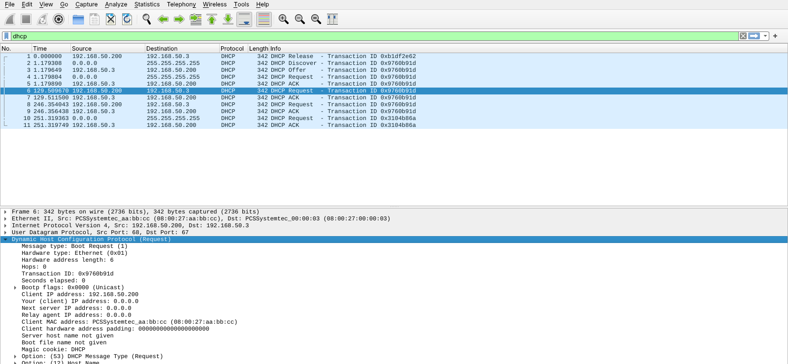

### 33. ¿Cambia el cliente automáticamente a SRV1 cuando vuelve a estar disponible?

**No, y la captura lo demuestra.** Con SRV1 encendido desde las 06:59:32, el cliente sigue con
**192.168.50.200 de SRV2** durante todo el experimento:

- Desde que arranca SRV1 **no hay ni un solo DHCPDISCOVER** (tramas 6–11). Sin DISCOVER no hay
  ocasión de que SRV1 haga una oferta.
- Las renovaciones (tramas 6 y 8) son **REQUEST unicast a 192.168.50.3**, el servidor guardado en
  la concesión (opción 54). SRV1 ni siquiera las recibe: su log no las registra.
- Como SRV2 contesta con ACK en T1, el cliente nunca llega a REBINDING ni a la expiración, que son
  los únicos caminos de vuelta a INIT.
- Incluso al **reiniciar el cliente** (trama 10), éste no empieza de cero: hace INIT-REBOOT
  pidiendo por broadcast su IP `.200`. SRV1 lo recibe, pero como no tiene ninguna concesión
  registrada para esa IP responde `unknown lease` y se calla, así que SRV2 la confirma.

DHCP no tiene mecanismo de "servidor preferido" ni de vuelta automática (*failback*). Una vez
concedida, la dirección se mantiene con quien la concedió mientras ese servidor siga renovándola.
El cliente solo podría acabar en SRV1 si vuelve al estado INIT y SRV1 gana la carrera: si SRV2
deja de responder y la concesión expira, si el cliente libera la concesión y olvida la guardada,
o si recibe un DHCPNAK.

---

## Resumen de lo comprobado

| Comprobación | Evidencia |
|---|---|
| Ambos servidores reciben el DISCOVER y ambos ofrecen | Parte 1: logs de SRV1 y SRV2; tramas 2 y 3 |
| El cliente elige la primera oferta | 15 de 15 pruebas: el ganador es siempre el primer OFFER |
| El perdedor se entera por la opción 54 del REQUEST broadcast | SRV1: `DHCPREQUEST for 192.168.50.200 (192.168.50.3) ... unknown lease` |
| El ganador no es predecible | 9 victorias de SRV2 y 1 de SRV1 en 10 pruebas; 5 de 5 para SRV1 al retrasar a SRV2 |
| La renovación no repite DORA | Parte 3: 2 tramas unicast, el otro servidor no registra nada |
| Caída del servidor: RENEWING → REBINDING → expiración → nueva IP | Parte 4: 12 REQUEST unicast, 2 broadcast, DORA con SRV2, `.100` → `.200` |
| No hay vuelta automática al servidor original | Parte 5: más de 4 minutos y un reinicio del cliente sin cambiar de servidor |
